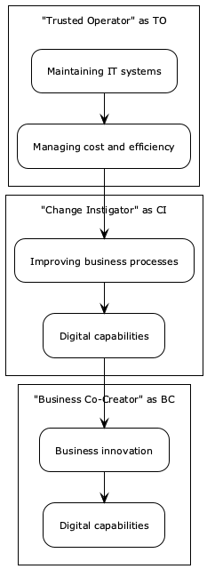
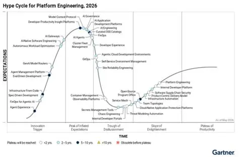

## High-Impact IT Leader #### Succeed as CIO/CTO/IT Director 2024!
[link to udemy course](https://www.udemy.com/course/high-impact-it-leader-succeeding-as-cioctoit-director/)

## Core Framework: Three Leadership Dimensions

### Lead the Business (LB)
#### Business Strategy
- co create bus sstrategy
- strategic part to CEO
- Opportunities affored by IT to others
- Align IT with business priorities
- Make money - more business, scale , more customers

#### Digital Transformation

### Lead the Operation (LO)
#### IT Strategy
- Run smoothly
#### IT Governance
- Optimize costs : automation, productivity
- ROI
#### IT Security
#### Business Resilience
- BCDR
- Stay out of trouble / compliance / risk / security

#### Service Management

### Lead the People (LP)
#### Project Delivery
#### IT Architecture
#### Leader Mindset
#### High-Performance Teams
#### Win-win IT Partnering
- win-win with partnership
#### Agile Organisation

## Three IT Leader Roles

## CIO.com Archetypes

CIO.com identifies 3 CIO archetypes based on whether the focus is on function, transformation or strategy.

### Functional CIO
Spends most of their time on:
- IT operations
- IT vendors
- IT budgets
- Working with IT team

### Transformational CIO
Spends most of their time on:
- Business processes
- Developing new applications
- Leading change
- Working with IT and business stakeholders

### Business Strategist CIO
Spends most of their time on:
- Business strategy
- Competitive analysis
- Business innovation
- Working with CEO and C-suite

## Questions for the IT Leader

Today's IT leaders are faced with many diverse questions:

- What is your IT strategy?
- Why do you need an IT budget of XXX? Can you justify?
- Tell me how we can save 10% from our IT spend next year?
- How will new technologies like cloud and analytics affect our business?
- Why is competitor X ahead of us in terms of customer experience and offering?
- Why are 50% of our projects either late or over-budget?

## Priorities

### Operational
Time, Budget, Results

### Transformational
Scale and Improve Processes

### Innovation
Evolve, Adapt, Experiment

### Organizational
Attract Great People

## Rate Yourself as a Leader

- You are good at getting results
- You understand the market environment
- You are business-savvy
- You take a strategic view when required
- You work well as part of a team
- You know how to get the best out of others
- You are comfortable and capable leading teams
- You get others to change
- Your clients value the working relationship with you

## Key Competencies

- Results Orientation
- Strategic Orientation
- Market Knowledge
- Commercial Orientation
- Customer Focus
- Change Leadership
- Team Leadership
- People Development
- Collaboration + Influence

## 6 Hats of an IT Leader

### Visionary
Strategic thinker, big-picture, futurist

### Action-man
Results-oriented, operationally-adept, finishes projects

### Captain
Builds teams, collaborates effectively

### Accountant
Commercial acumen, financially-astute

### Customer
Customer empathy, customer experience

### Engineer
Technically-adept, engineer solutions

## The Shortening Lifespan of Fortune 500 Companies

**The trend:** Only 8 of the Fortune 500 companies from 1955 survived to 2014. Meanwhile, companies like Facebook, Microsoft, and eBay rose to prominence. Today, most companies can only maintain Fortune 500 status for less than 15 years—down significantly from the 59-year tenure of earlier generations.

**Why?** Digital disruption, faster market cycles, and technology-driven competition have accelerated the pace of business failure. Legacy businesses struggle to transform faster than new entrants can disrupt them.

**For IT Leaders:** Business survival now depends on continuous digital innovation and organizational agility, making IT strategy central to corporate longevity.

## Marketing myopia
Kodak: sold film rather than customer needs to take pictures

Blockbuster sold DVDs rather than customer need to watch

dont sell surgery, sell the need to be well

## Reimagine Business: How Will Business Look in the Future?

### Three Critical Questions

**What shifts and trends are we seeing in the industry?**
- Market dynamics and technological disruption
- Regulatory and compliance shifts
- Industry consolidation or fragmentation
- New business models emerging

**What do we see in terms of customer preferences?**
- Changing customer expectations and behaviors
- New channels and engagement models
- Quality, price, and service expectations
- Sustainability and ethical considerations

**Where are our competitors having success?**
- New market entrants and their strategies
- Incumbent transformation efforts
- Partnerships and ecosystem plays
- Technology-enabled competitive advantages

### Strategic Imperative

Understanding these three dimensions helps IT leaders anticipate where the business needs to go and ensure technology roadmaps align with future market realities, not just today's operations.

## Vision Cone: Navigating Uncertainty

### The Framework

The Vision Cone illustrates how predictability decreases as we look further into the future:

**Past (Easier to Predict)** → **Now** → **Future (Harder to Predict)**

VUCA = Volatile + Uncertain + Complex + Ambiguous

### Three Scenarios for the Future

- **Possible:** A range of outcomes that could occur
- **Probable:** The most likely outcomes based on current trends
- **Unlikely:** Low-probability but high-impact scenarios

### Strategic Direction

An effective IT strategy requires:
1. **Industry trends and "signals"** - Stay alert to emerging patterns
2. **Clear direction** - Define the probable future and strategic roadmap
3. **Range of possibilities** - Build flexibility into IT architecture to adapt as the future unfolds

As an IT leader, your role is to chart a direction amid uncertainty while maintaining the agility to pivot as the business environment becomes clearer.

## Strategic Vision Examples & Key Takeaways

Companies like Microsoft, Amazon, Google, Tesla, Visa, Disney, DBS, McDonald's, and IKEA share common patterns in their strategic visions:

**What great visions have in common:**
- **Customer-centric** - Focused on customer needs, not products (Amazon's "Earth's most customer-centric company")
- **Clear and simple** - Memorable and concise (Google's "Access to information in one click")
- **Ambitious but believable** - Bold enough to inspire, grounded enough to guide action (Tesla's electric vehicle transition)
- **Value-driven** - Clear articulation of the benefit being created (IKEA's affordability, Visa's accessibility)
- **Globally scoped** - Transcends geographic or market boundaries
- **Transformation-oriented** - Signals industry change, not incremental improvement
- **Technology-enabled** - Recognizes that digital is central to delivery (DBS making banking "joyful" through technology)

**For IT leaders:** A compelling strategic vision provides direction for technology investments while helping the organization understand *why* digital transformation matters.

## Strategic IT Grid: 4 Ways to Think About IT Strategy

A 2x2 framework combining Business vs Technical focus with Efficiency vs Growth:

### Business Efficiency (Efficiency + Business Focus)
Reduce cost of doing business through IT
- Automation and process optimization
- RPA, workflow efficiency
- Core system modernization

### Business Innovation (Growth + Business Focus)
Increase business revenue and reach through IT
- New digital offerings and channels
- Data-driven customer experiences
- Platform and ecosystem plays

### Technical Efficiency (Efficiency + Technical Focus)
Reduce cost of IT operations
- Cloud migration and cost optimization
- Infrastructure consolidation
- Legacy system retirement

### Technical Innovation (Growth + Technical Focus)
Explore promising emerging technologies
- AI, machine learning, blockchain
- IoT and edge computing
- Quantum computing research

**Strategic Balance:** Most IT organizations need a portfolio approach—balancing efficiency (reducing cost) with growth (enabling new business) across both business and technical dimensions.

### Impact of Good vs. Poor IT Strategy

**Poor IT strategy = "Brakes"** — Reduces competitive advantage, misses opportunities, and drains resources through excessive IT spending, potentially leading to business failure.

**Good IT strategy = "Enabler"** — Drives business momentum, enables competitive differentiation, and optimizes operational efficiency.

### 1 Page IT Strategy = IT Pyramid

A complete IT strategy framework organized hierarchically:

**Level 1: Business Strategy** (Foundation alignment)
- Business vision, directions and goals

**Level 2: IT Vision**
- What the IT future looks like

**Level 3: IT Roadmap**
- IT direction and overarching plans

**Level 4: IT Portfolio**
- IT projects and investments

**Level 5: IT Platforms**
- IT architecture and infrastructure

**Level 6: IT Operations** (Base execution)
- IT resourcing and partners

**Key principle:** Each level must align with and support the level above it. The pyramid shows that strong IT operations (base) are necessary but not sufficient—strategy must flow from business vision down through IT vision, roadmap, portfolio, and platforms.

#### Example: IT Pyramid for NTU (Nanyang Technological University)

**Business Strategy**
- A great global university founded on science and technology, nurturing leaders through research and a broad education in diverse disciplines
- A transformative leader in education

**IT Vision**
- Use technology to create a smart campus that enhances the university experience

**IT Roadmap**
- 2021: Online learning labs
- 2022: Virtual reality lecture theatres
- 2023: Automated canteen, Autonomous Buses

**IT Portfolio**
- Digital learning
- Autonomous transport
- VR labs
- Cloud migration
- Student App V2

**IT Platform**
- 70% Cloud (AWS)
- All services via APP or Web
- Microservices architecture

**IT Operations**
- In-house IT team of 50 distributed across schools
- Amazon AWS for cloud partnership
- 20 IT partners in specialist areas
- Annual budget of $4-10 million

**Key observation:** NTU's IT strategy clearly flows from business vision (transformative education leader) through technology enablement (smart campus) into concrete roadmaps, managed portfolio, cloud-first platforms, and distributed operations.

### avoid jump onto bandwagon mentality
early adopters may undergo newbie resource wastage

Gartner hyper cycle

Gartner’s framework has five stages: Innovation Trigger, Peak of Inflated Expectations, Trough of Disillusionment, Slope of Enlightenment, and Plateau of Productivity. Gartner says technologies often take three to five years to move through the cycle, although some fail to reach mainstream adoption. 
Gartner
The central 2026 message: agentic AI is at the peak
Gartner places agentic AI at the Peak of Inflated Expectations, with strong market attention but uneven maturity.

## Gartner's IT Strategy Model

Similar to the IT Pyramid, Gartner's model shows how IT strategy flows from business strategy and comprises multiple layers:

**Business Level**
- Business Strategy (Actual or Derived)

**Business/IS Level** (Two IS Units)
- **Applications** — Change, Prove Effective
- **Operations** — Services, Prove Efficient

**Support Elements**
- **Architecture** — Building Blocks
- **Financial Tools** — Decisions

**IS Internal** (Manage Internal/External)
- **People** — Maximize Potential

This model emphasizes that IT strategy must balance two critical IS units: Applications (driving change and effectiveness) and Operations (ensuring efficiency). Both are supported by architecture decisions, financial planning, and people management.

## More revenue oppritunities:
- Apple : desktop/hardware - but also sells services: music/TV/games/cloud.
- AirAsia: hotels/vacations/wallet
- Oracle: DB + services/consulting/ERP/wholesome
- Disney: Film: toys/comics/theme park/comics

## References

### Under Armour: Technology as Business Enabler
Under Armour CEO says the company is a technology company where technology enables business innovation. Rather than being a traditional athletic apparel company that uses tech, they view themselves fundamentally as a technology-driven organization.

Video: https://youtu.be/_mMTixdHC3A

**Key insight for IT leaders:** This reframing is critical—IT is not support for the business, IT IS the business. Organizations that excel are those where the CIO/CTO and business leadership view technology as the core competitive advantage, not a cost center.

### Arcelor Mittal: Focus on Technology Efficiency
Arcelor Mittal (ArcelorMittal), the world's largest steelmaker, focuses on technology efficiency—optimizing IT operations to reduce costs while maintaining business continuity.

Video: https://www.youtube.com/watch?v=XjWuOusNnWs

**Key insight for IT leaders:** Even in traditional manufacturing industries, IT efficiency is strategic. The quadrant of "Technical Efficiency" (reducing cost of IT operations through cloud, automation, etc.) is critical for companies with large operational IT footprints.

### book
Gartner’s framework has five stages: Innovation Trigger, Peak of Inflated Expectations, Trough of Disillusionment, Slope of Enlightenment, and Plateau of Productivity. Gartner says technologies often take three to five years to move through the cycle, although some fail to reach mainstream adoption. 
Gartner
The central 2026 message: agentic AI is at the peak
Gartner places agentic AI at the Peak of Inflated Expectations, with strong market attention but uneven maturity.