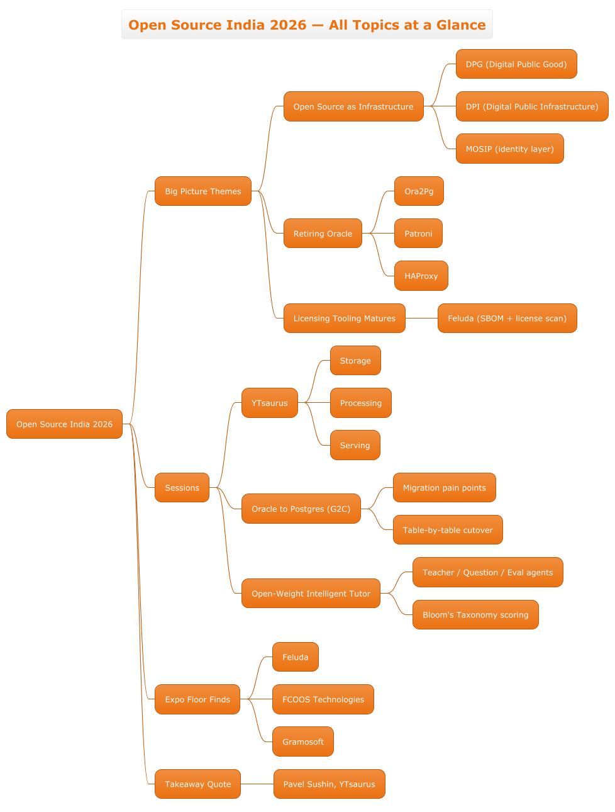
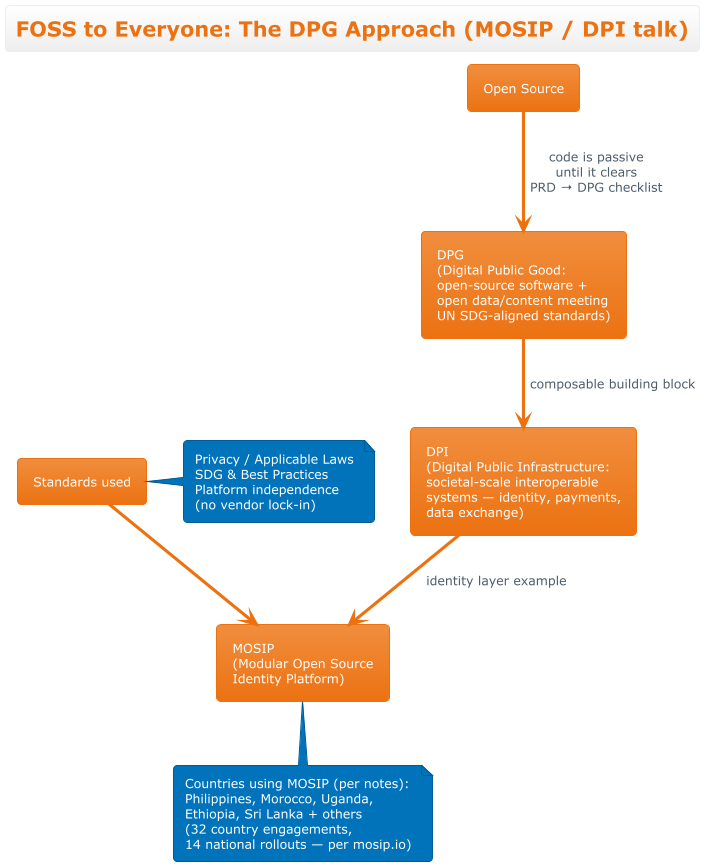
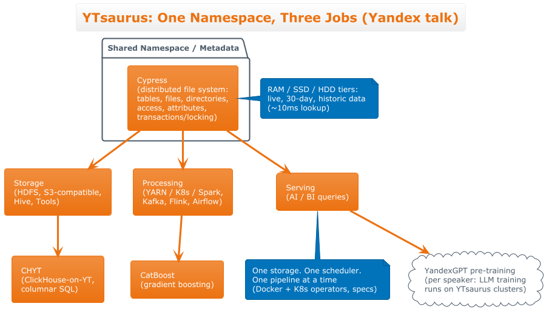
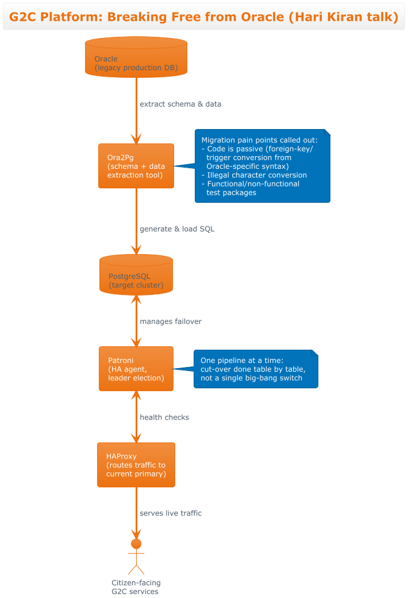
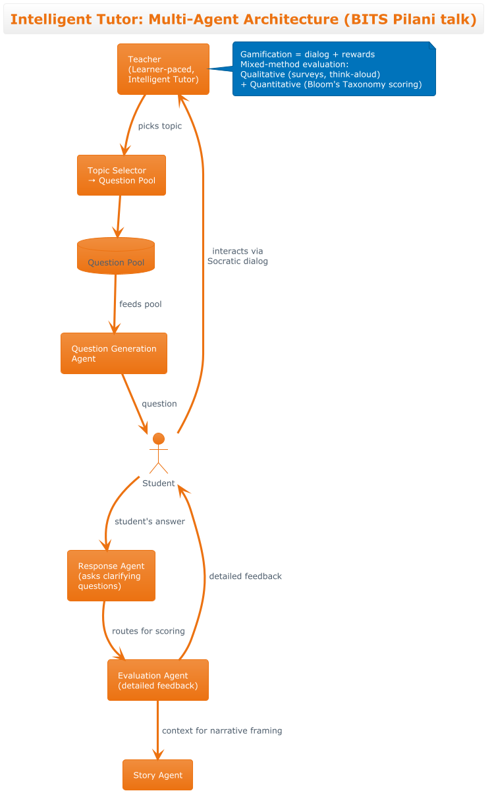

# 5 Biggest Takeaways from Open Source India 2026 (And Why Postgres Just Won Another Fight)

*Notes from the floor and the talk tracks at NIMHANS Convention Center, Bengaluru — October 8, 2026.*

> "The same cluster runs an exabyte-scale ETL pipeline, an interactive SQL workload, and LLM pre-training on shared hardware."
> — Pavel Sushin, Head of Analytics Tools Engineering & Operations, YTsaurus

That line stuck with me more than anything else said that day — not because it's a flashy demo, but because it's a direct rebuttal to the idea that you need five different vendors and five different bills to do data warehousing, ETL, and model training. One open-source platform, one cluster, three jobs.

## Prelude

Open Source India (OSI) is organized annually by Open Source For You (OSFY/EFY), and this year's edition ran October 7–8 at NIMHANS Convention Center in Bengaluru, split across ten tracks — FOSS, DevOps, AI/ML, Data & Databases, Developers' Meet, and Open Source Hardware among them. The floor and the talk tracks had a distinctly different energy from the typical "AI slapped on a banner" circuit — this was a crowd of people who read license files for fun, and the talks matched that: migrations, licensing tooling, and infrastructure platforms, not pitch-deck demos.

**In short:**
- A government G2C (government-to-citizen) platform walked through exactly how it broke free of Oracle and moved to PostgreSQL — not hand-wavy, but the actual migration pain points.
- Yandex's YTsaurus made the case that one open-source platform can replace your entire "Hadoop zoo" of point tools.
- A BITS Pilani professor showed a multi-agent architecture for AI tutoring that uses *open-weight* models specifically so under-resourced schools aren't locked into GPU-hungry, API-metered tutors.

## The Lay of the Land

**Current 1 — Open source as infrastructure, not ideology.** Every major talk treated "open source" as a practical cost and control lever, not a philosophy. MOSIP's framing of Digital Public Goods (DPG) and Digital Public Infrastructure (DPI) was the clearest version of this: a DPG, per the Digital Public Goods Alliance, is open-source software, open data, or open content that adheres to applicable laws, does no harm, and helps meet the UN Sustainable Development Goals. DPI is the broader idea — societal-scale, interoperable digital systems (identity, payments, data exchange) often *built from* DPGs. MOSIP is the identity layer: per mosip.io it's now engaged across 32 countries with 14 national rollouts, including Morocco, Uganda, Ethiopia, Sri Lanka, and the Philippines.

Links

- Digital Public Goods Alliance definition: https://digitalpublicgoods.net/
- MOSIP: https://mosip.io
- MOSIP on Wikipedia: https://en.wikipedia.org/wiki/MOSIP

**Current 2 — "Rip out Oracle" is a mainstream migration story now, not a fringe one.** This showed up constantly: Ora2Pg for schema/data extraction, Patroni for Postgres high availability, HAProxy for routing — this stack came up in more than one session as the default way teams are exiting Oracle licensing.

**Current 3 — Licensing and compliance tooling is maturing fast.** Feluda (github.com/anistark/feluda), a Rust-based CLI that scans `node_modules`, `pip` files and more across nearly a dozen ecosystems for license risk and generates SBOMs (SPDX/CycloneDX), was a good proof point — compliance scanning that used to be a manual legal review is becoming a CI/CD step.

**What was missing:** almost no one on stage was talking about *new* foundation models — the AI talks were about tutoring architectures and LLM infrastructure (training platforms), not new base models. The open-source AI story here is "infrastructure and applications," not "models."

## On the Main Stage

### 1. YTsaurus: one platform instead of a Hadoop zoo

**In a nutshell:** YTsaurus is Yandex's open-sourced (2023) distributed big-data platform — one shared metadata namespace ("Cypress") backing storage, processing, and serving, instead of stitching together HDFS + Spark + a separate serving layer + a separate scheduler.

**On stage:** Pavel Sushin's keynote broke the platform into exactly three jobs sitting on one namespace: **Storage** (HDFS, S3-compatible, Hive), **Processing** (YARN/K8s/Spark, Kafka, Flink, Airflow), and **Serving** (AI/BI queries, including CHYT — ClickHouse running directly on YTsaurus data, and CatBoost, Yandex's own gradient-boosting library). The pitch: run live, 30-day, and historic data tiers (RAM/SSD/HDD) with ~10ms lookups, and — per the speaker — the same clusters handle LLM pre-training workloads.

Links

- YTsaurus: https://ytsaurus.tech/
- GitHub: https://github.com/ytsaurus

**The upshot:** If you're running a typical "collect data → batch process → train a model → serve results" pipeline across four separately-billed systems, this is a direct argument for collapsing that into one. The catch, which the speaker was upfront about: self-hosting means your own GPUs and full operational control, versus the rent-and-forget model of Databricks/Snowflake.

### 2. How India's largest G2C platform broke free from Oracle

**The setup:** Hari Kiran (Founder & CEO, OpenSource DB) walked through a real production migration of a large government-to-citizen (G2C) platform off Oracle and onto PostgreSQL.

**How it played out:** The migration path was Ora2Pg for schema and data extraction, then Patroni for automatic leader election/failover on the new Postgres cluster, with HAProxy in front routing traffic only to the current primary. The honest part of the talk — the part that makes it worth writing about — was the pain-point list: Oracle-specific trigger/foreign-key syntax doesn't translate cleanly ("code is passive" until someone manually converts it), illegal-character handling differs between the two databases, and the team built out dedicated functional and non-functional test packages rather than trusting the migration tool blindly. The cutover itself went table by table — one pipeline at a time, not a big-bang switch.

Links

- Ora2Pg: https://ora2pg.darold.net
- Patroni: https://patroni.readthedocs.io

**Why bother:** This is the difference between a "look, Postgres can do it too" marketing talk and an actual runbook. If you're staring down an Oracle license renewal, this is the realistic version of what the exit costs in engineering effort — not the vendor-brochure version.

### 3. An intelligent tutor built entirely on open-weight models

**The pitch:** Prof. Jagat Sesh Challa (BITS Pilani) presented a multi-agent intelligent tutoring system deliberately built on open-weight models instead of closed APIs — explicitly to make AI tutoring viable for institutions that can't afford per-token GPU bills at scale.

**Under the hood:** The architecture split the tutor into distinct agents rather than one do-everything chatbot: a Teacher agent runs a Socratic, gamified dialog (dialog + rewards, not just Q&A); a Topic Selector feeds a Question Pool; a Question Generation agent asks the student; a Response agent asks clarifying questions when answers are ambiguous; and an Evaluation agent gives detailed feedback, with a Story agent wrapping context into narrative framing. Evaluation itself was mixed-method — qualitative (student surveys, think-aloud sessions) plus quantitative scoring against Bloom's Taxonomy (the standard framework for categorizing learning objectives from basic recall up to analysis and creation).

Links

- Bloom's Taxonomy: https://en.wikipedia.org/wiki/Bloom%27s_taxonomy

**Worth noting:** "No need of GPUs" was the line in the notes, and it's the right framing — this talk was really about designing an AI system around a budget constraint, not around what's technically maximal. That's a more honest engineering problem than most AI talks admit to.

## Sleepers Worth a Second Look

Two stalls, easy to miss between the main-stage talks:

**Feluda** (github.com/anistark/feluda) — a license-compliance scanner built by Bangalore-based developer Anirudha ("anistark"), who's also active in the Python India / BangPypers community. It's a Rust CLI that scans dependencies across nearly a dozen language ecosystems, flags licenses that are legally risky for your project, and generates an SBOM (software bill of materials) in SPDX or CycloneDX format — plus NOTICE files, and it plugs into CI/CD (GitHub Actions, Jenkins, GitHub Advanced Security/SARIF). If your legal team still does license review by hand, this is the tool that makes that unnecessary.

**FCOOS Technologies and Gramosoft** — two smaller consultancy booths worth a mention for contrast rather than a deep dive. FCOOS pitches "secure, open, future-ready" IT infrastructure (pfSense/OPNsense firewalls, NAS/backup, Google Workspace/ERPNext integration) — the unglamorous but necessary open-source-powered IT-services end of the ecosystem. Gramosoft, by contrast, was a broader "we do everything" dev shop (GenAI, RPA, web scraping, Oracle core banking) — less a product than a staffing pitch, and a useful reminder that not every booth at an open-source conference is actually about open source.

## The Line That Stuck

Already led with it, but it's worth restating as the single idea to take away: Pavel Sushin's framing that ETL, interactive analytics, and LLM pre-training can run on the *same* cluster, under the *same* namespace, is the clearest argument I heard all day for why "unify your data platform" isn't just a vendor slogan — it's something a sufficiently mature open-source stack can now actually deliver.

---

*Have a correction or want to add context to any of these talks? I'd rather get it right — leave a note.*
