# Bengaluru Tech Summit 2026 Recap: Top Innovations & Booth Highlights

*Walking the floor at BIEC on November 18, 2026*

## Event Vibe

The [Bengaluru Tech Summit](https://www.bengalurutechsummit.com/) took over BIEC from November 17–19, and the exhibition floor was a genuine mixed bag — big-vendor infrastructure stalls (HPE, Dell, VMware, Palo Alto partners) shoulder to shoulder with a dense Startup Pavilion packed with two-person teams running on QR codes and hope. The energy skewed developer- and founder-heavy rather than pure enterprise procurement — lots of "here's my product, scan this" pitches, fewer glossy enterprise theater booths.

I walked the floor specifically hunting for teams that were *actually shipping* — live demos, working hardware, real terminal output — versus the ones that had simply stapled "AI" onto an existing pitch deck. Both kinds showed up in force.

## Quick-Reference Index

- **Most Underrated Tool:** PathShodh's anuPath™ nano glucometer — unglamorous booth, serious medtech (30 patents across 8 countries, CDSCO-licensed).
- **Coolest Booth/Product Display:** Hoopoe E-Bikes' XO-RIDE — an actual electric dirt bike parked under neon lighting, not just a banner.

## The Booth-by-Booth Breakdown

### Hardware, Chips & Deep Tech

#### 1. SierraEdge AI — Indigenous semiconductor design + AI/DefTech
- **What they showcased:** PinnacleAI, a full-stack platform for managing the semiconductor design lifecycle (architecture → RTL → physical design → post-silicon firmware), plus a DefTech arm covering radar, satellite comms, UAV perception, and cryptography — all pitched as "sovereign" / India-built.
- **Why it stood out:** Most AI booths show you a chatbot. This one showed an actual design-lifecycle diagram with named phases and a defense-communication stack spanning 5G, NavIC-GPS, LoRa, and mesh networking — a genuinely different category of "AI company."
- **My Takeaway:** Niche but serious — this is for defense-adjacent hardware teams, not general SaaS buyers. Founder Girish Desai (ex-Synopsys, ex-Intel) was staffing the booth himself.

View brochure

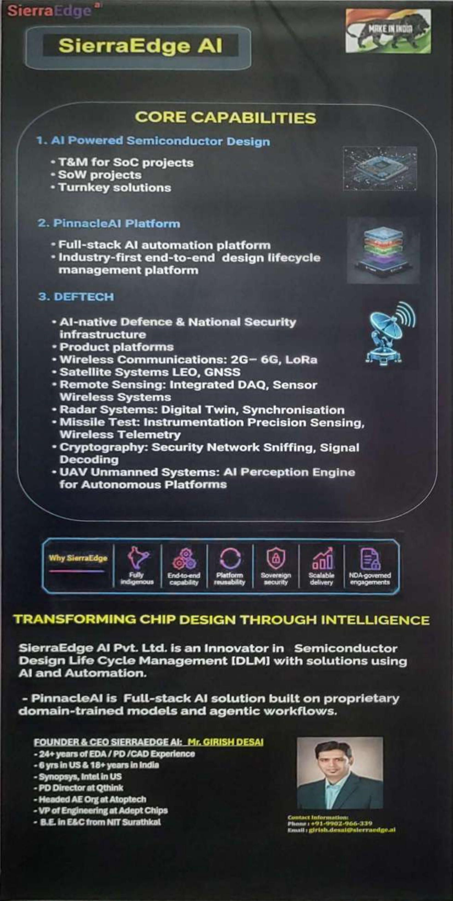
*SierraEdge AI — founder profile and contact brochure.*

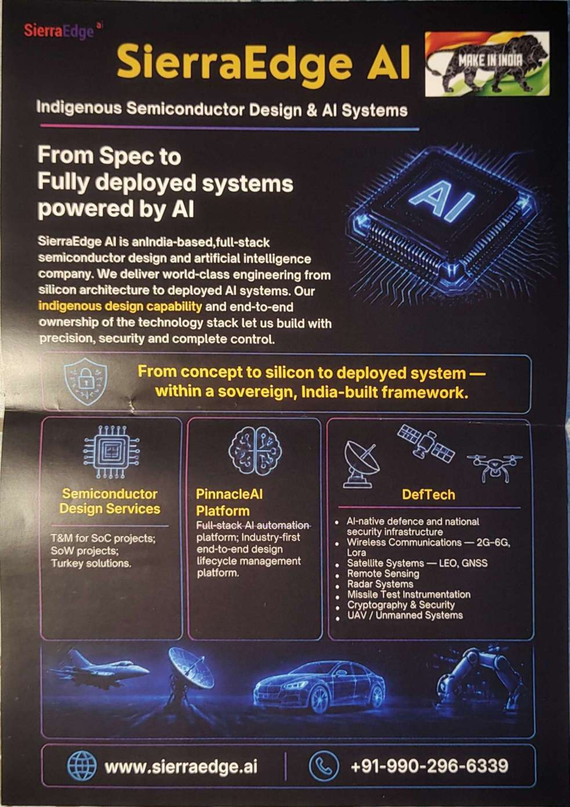
*SierraEdge AI — core capabilities: semiconductor design, PinnacleAI platform, DefTech.*

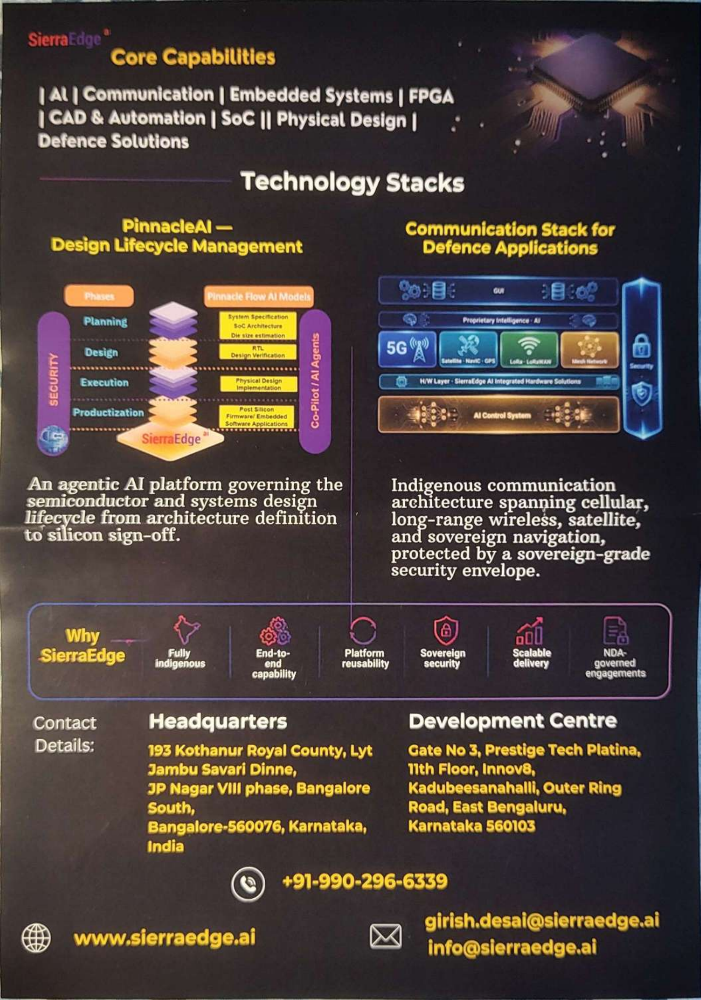
*SierraEdge AI — PinnacleAI design-lifecycle diagram and defence communication stack.*

#### 2. dSPACE — Model-to-hardware-to-radar testing
- **What they showcased:** Three live tools — Neural Net Coder (turns ONNX models into MISRA-C-compliant safety-critical code), SCALEXIO Essential (compact hardware-in-the-loop testing with CAN/LIN/FlexRay), and DARTS ARROW (a radar target simulator operating 76–81 GHz).
- **Why it stood out:** This is the automotive-safety end of "AI" that almost nobody else at the summit was touching — ISO 26262 compliance, not prompt engineering.
- **My Takeaway:** Useful if you're in automotive or safety-critical embedded systems; irrelevant otherwise, but a nice reminder that "AI" at this summit meant wildly different things depending on the booth.

View brochure

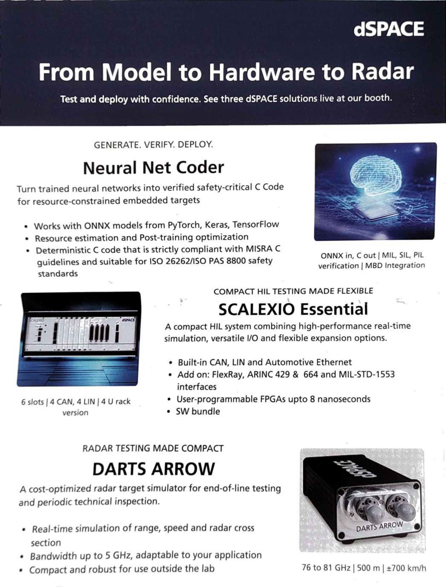
*dSPACE — Neural Net Coder, SCALEXIO Essential and DARTS ARROW product panels.*

*dSPACE — DARTS ARROW spec sheet and booth contact details.*

#### 3. XP Skills — Hands-on robotics education
- **What they showcased:** Humanoid and quadruped robots plus robotic arms, pitched as a "simulation to real robots" training pathway for students.
- **Why it stood out:** Actual working robots on the floor, not just posters — the quadruped was drawing a steady crowd.
- **My Takeaway:** Solid for robotics education programs; worth a look if you run a STEM lab.

View brochure

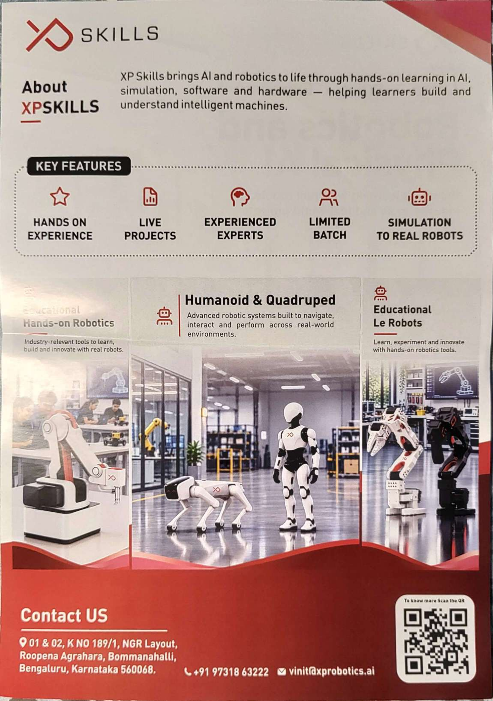
*XP Skills — hands-on robotics, humanoid/quadruped robots, and educational robotic arms.*

### Developer Tools, Infra & AI Platforms

#### 4. Algorizz Labs — "CTO-grade thinking, startup-grade speed"
- **What they showcased:** A stack spanning agentic AI, computer vision, and data platforms, with flagship products LoomOS (manufacturing-floor OS), HighwayOS (traffic/tolling intelligence), and MarineOS (vessel-fleet monitoring), plus smaller frameworks for ed-tech voice tutoring, outbound call automation, and AI-run interviews.
- **Why it stood out:** The breadth was almost suspicious until you saw the "Advise → Build → Run" framing — this reads like a boutique AI consultancy that productized its best repeat engagements rather than a single-product startup.
- **My Takeaway:** Worth a conversation if you need senior AI/data judgment rather than another no-code wrapper.

View brochure

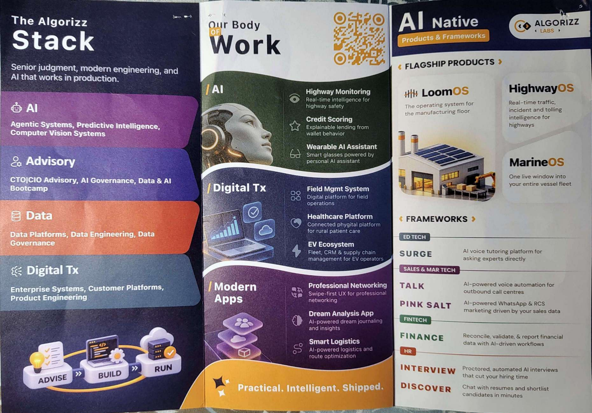
*Algorizz Labs — the Algorizz stack, body of work, and flagship products (LoomOS, HighwayOS, MarineOS).*

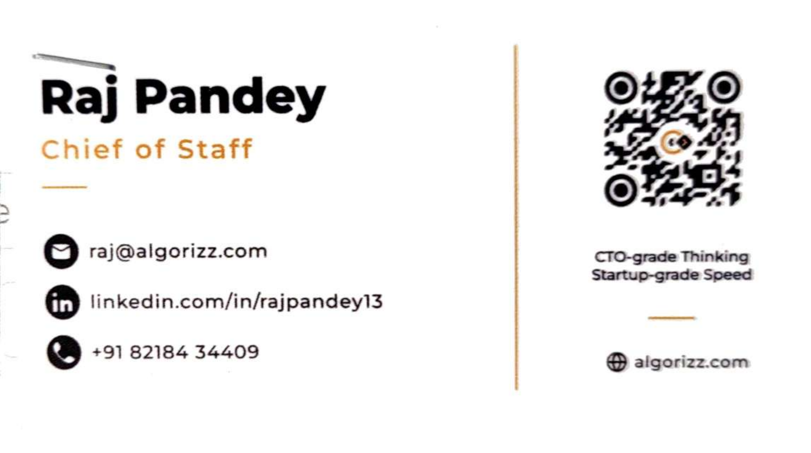
*Algorizz Labs — Raj Pandey, Chief of Staff, business card.*

#### 5. QUTRIX / StaffAtom / OpsMetry — a three-headed SaaS/CoE group
- **What they showcased:** A workforce-management marketplace (StaffAtom), a quality-engineering/test-automation platform with "zero AI token dependency" (OpsMetry), and an umbrella engineering/cloud CoE (QUTRIX) tying them together.
- **Why it stood out:** Shared booth, shared backend, three distinct go-to-markets — an efficient way to cover workforce ops, QA, and cloud engineering pitches in one stop.
- **My Takeaway:** If you're evaluating workforce platforms or test-automation tooling, worth comparing OpsMetry's "no AI token cost" framing against the usual LLM-per-test-case vendors.

View brochure

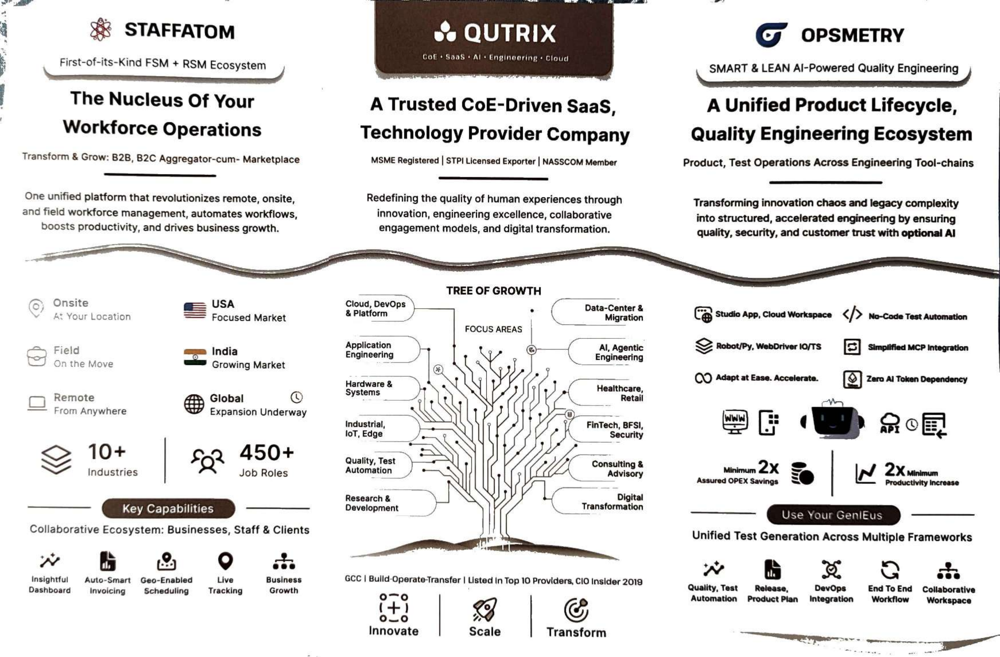
*StaffAtom / QUTRIX / OpsMetry — tri-panel overview of the workforce, CoE and quality-engineering products.*

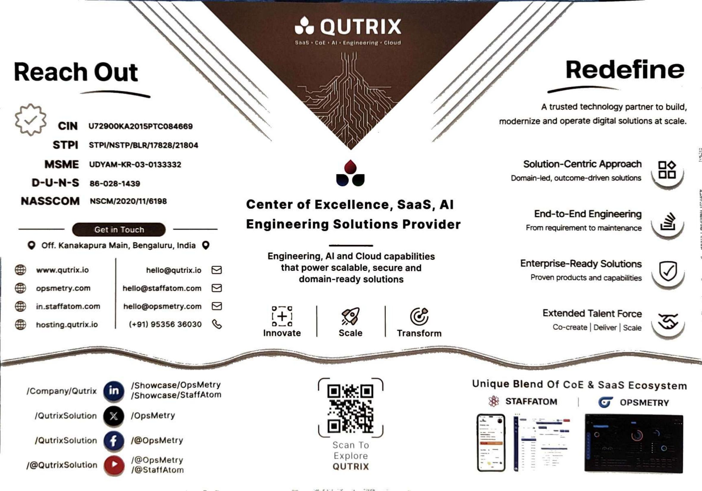
*StaffAtom / QUTRIX / OpsMetry — shared contact and registration details.*

#### 6. Bizzomation (powered by Finwell Growth Solutions) — Operations suite
- **What they showcased:** A three-portal (Admin/Staff/Client) ops platform — workflow builder, checklists with proof, payroll, five analytics dashboards, WhatsApp/Zoom/Tally integration — with tiered pricing from ₹9,999 to custom enterprise.
- **Why it stood out:** The "without a system vs. with Bizzomation" comparison boxes were a clean, honest way to pitch ops software instead of a feature wall.
- **My Takeaway:** A reasonable fit for SMBs currently running operations over WhatsApp and spreadsheets; the ₹9,999/month entry tier is a low-risk way to try it.

View brochure

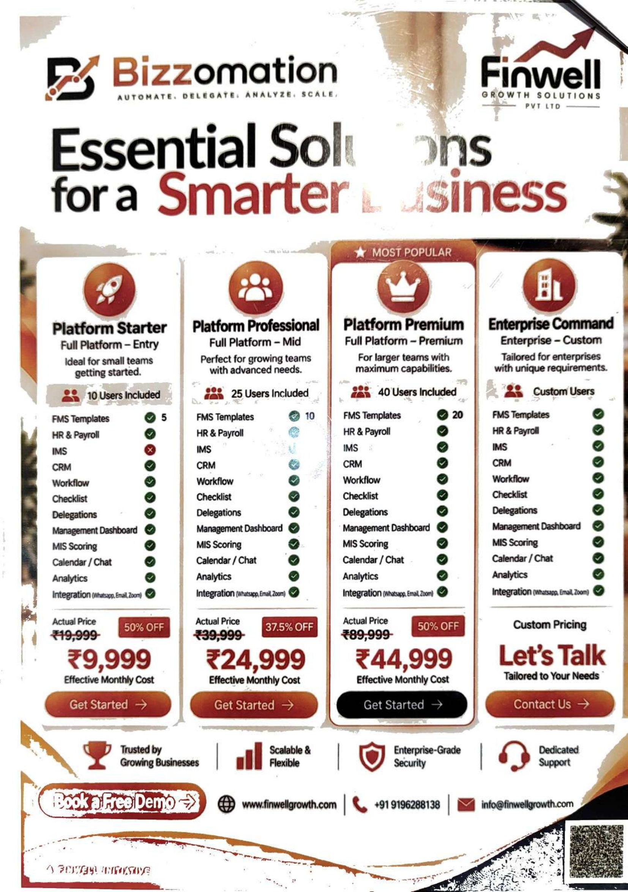
*Bizzomation — pricing tiers from Platform Starter to Enterprise Command.*

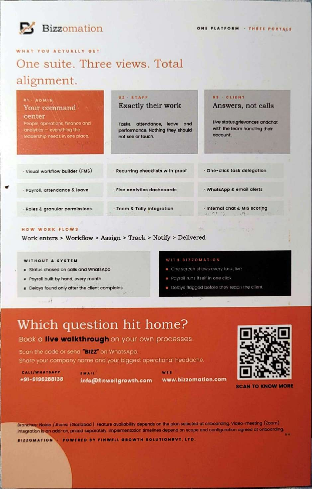
*Bizzomation — Admin/Staff/Client portal breakdown and "with vs. without" comparison.*

#### 7. VirpanAI (by WAIOZ) — No-code e-commerce storefront builder
- **What they showcased:** A Shopify-style store builder (variants, coupons, inventory, WhatsApp order alerts, multi-location shipping) at a flat ₹1,00,000 lifetime price, with claims of 500+ stores already built.
- **Why it stood out:** Lifetime pricing is unusual in this space — most competitors are subscription-only.
- **My Takeaway:** Worth comparing total cost of ownership against Shopify/WooCommerce over a 2–3 year horizon before committing to the lifetime fee.

View brochure

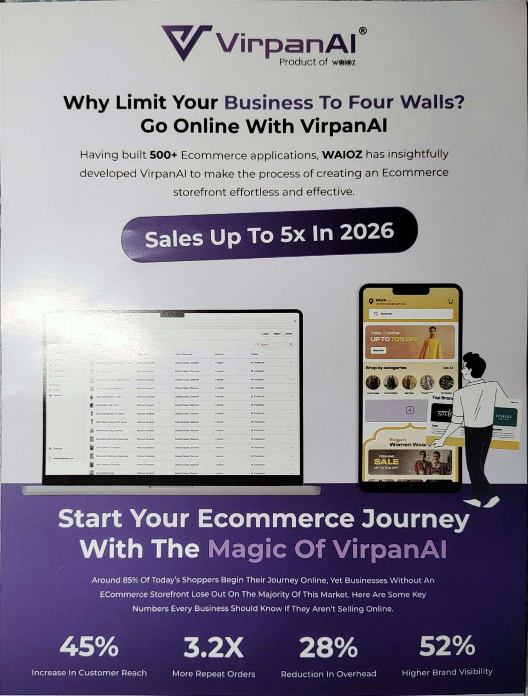
*VirpanAI — storefront builder pitch, by WAIOZ.*

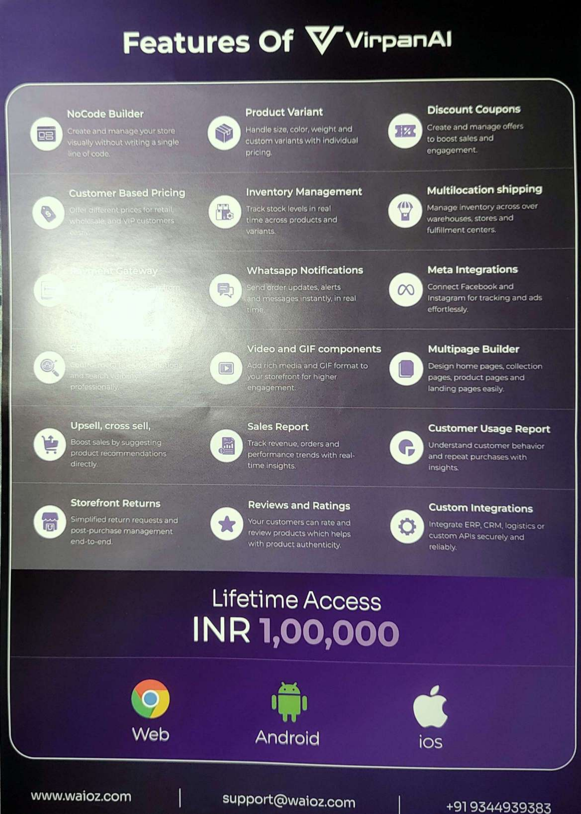
*VirpanAI — feature grid and ₹1,00,000 lifetime pricing.*

### HR, Hiring & Talent

#### 8. HireXt — AI mock interviews and coding assessments
- **What they showcased:** AI-powered mock interview sessions (with a live two-way video interface), coding-round practice, and personalized performance analysis, aimed squarely at students about to face campus placements.
- **Why it stood out:** The messaging was refreshingly specific — "nervous about interviews, struggling with coding rounds" — rather than generic upskilling language.
- **My Takeaway:** A clear fit for campus placement cells and bootcamps; less relevant for experienced hires.

View brochure

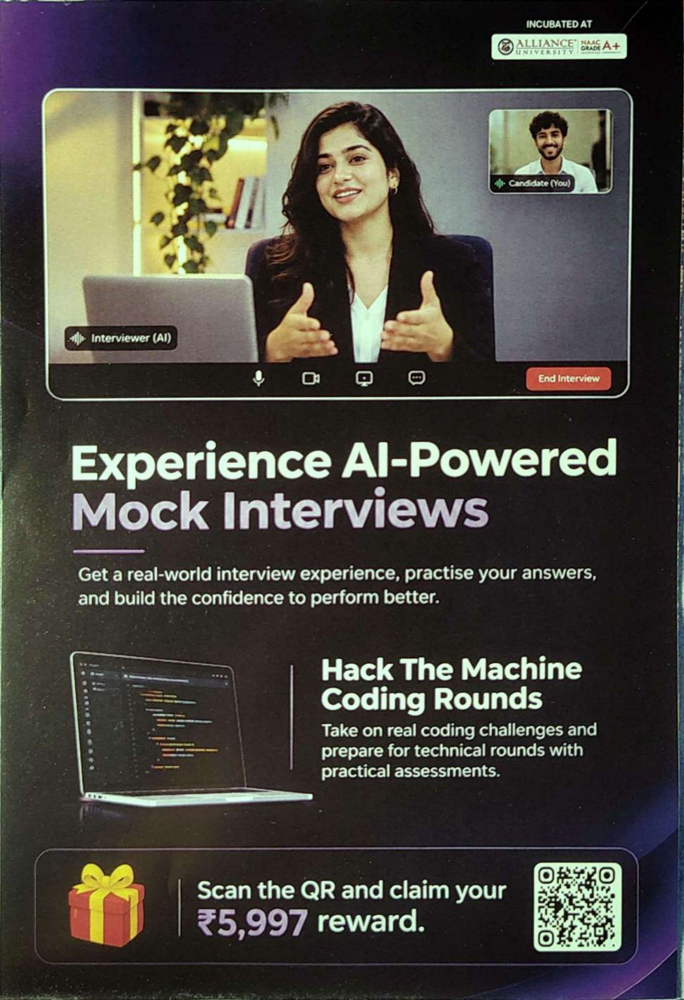
*HireXt — AI-powered mock interview and coding-round interface.*

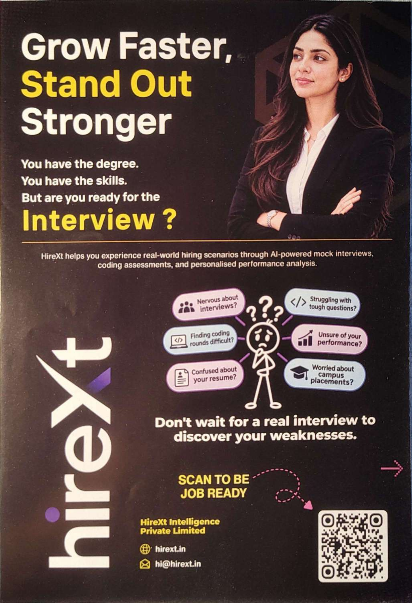
*HireXt — "Grow Faster, Stand Out Stronger" campus-placement pitch.*

#### 9. CloudRek — Global recruiting marketplace
- **What they showcased:** A sourcing-to-placement pipeline (AI matching → validation → shortlist in 8–24 hours → interview support → onboarding), claiming 20M+ job seekers and clients across India and the US, with named references like Randstad India and Barracuda Networks.
- **Why it stood out:** The named client list and "8-24 hour shortlist" SLA gave it more credibility than most recruiting-tech pitches on the floor.
- **My Takeaway:** Worth a look for companies doing high-volume technical hiring across India/US.

View brochure

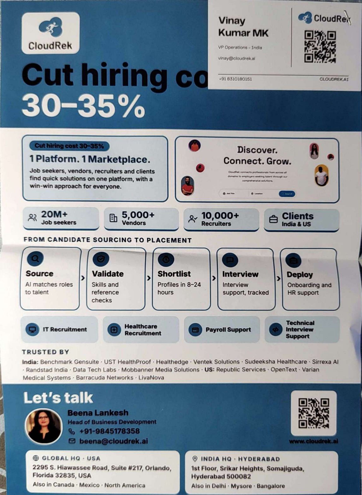
*CloudRek — sourcing-to-placement pipeline flyer with Vinay Kumar MK's business card attached.*

#### 10. JobsifyAI / Knowledge Artisans — Free job posting + AI fitment scoring
- **What they showcased:** Free job postings scored against every applicant automatically, bulk CV matching (25 at once), and a 13-stage hiring pipeline, backed by Knowledge Artisans' staffing and GCC/ODC setup services.
- **Why it stood out:** "Post a role free, every applicant scored" is a genuinely simple pitch, and the stats they quoted (35,500+ candidates, 250+ live roles) were dated and sourced rather than vague.
- **My Takeaway:** An easy, low-cost way to test AI-assisted shortlisting before buying a full ATS.

View brochure

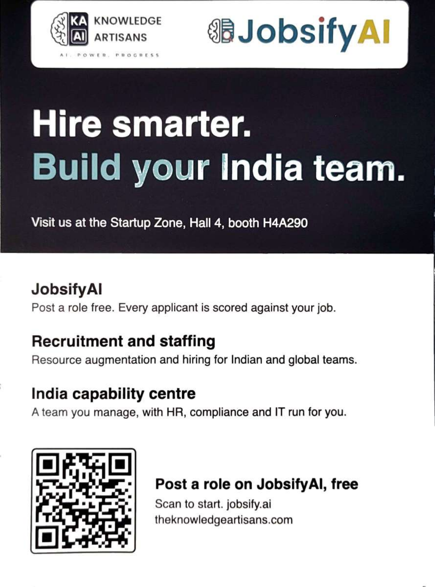
*JobsifyAI / Knowledge Artisans — "Hire smarter, build your India team" front panel.*

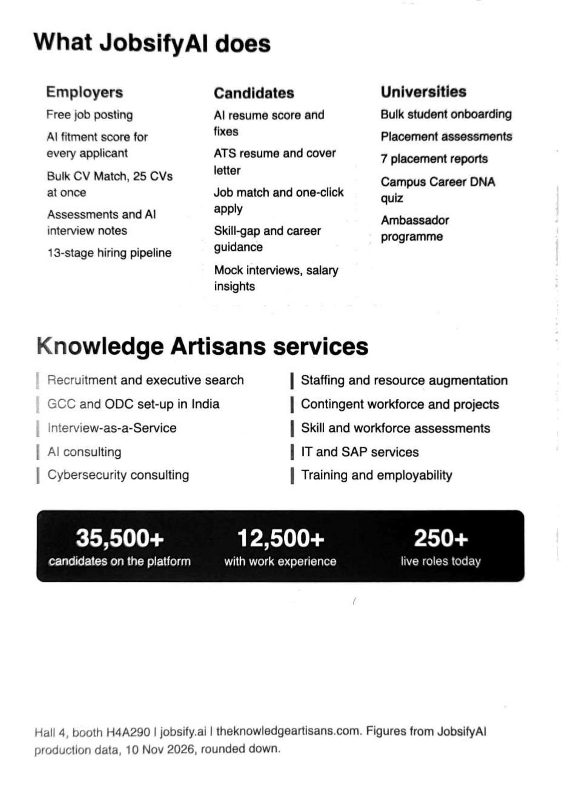
*JobsifyAI / Knowledge Artisans — feature breakdown for employers, candidates and universities.*

### HealthTech & Sustainability

#### 11. PathShodh Healthcare — anuPath™ nano Glucometer
- **What they showcased:** A glucose-testing device with a 10-second test time, 1 µL sample size, and clinical validation by India's National Institute of Biologicals — backed by 30 patents across 8 countries.
- **Why it stood out:** No flashy demo screen, no QR-code funnel — just a genuinely well-documented, regulator-cleared medical device at a booth easy to walk past.
- **My Takeaway:** This is the kind of booth you have to actually stop and read to appreciate — more substance than spectacle, and probably underrated by most of the foot traffic.

View brochure

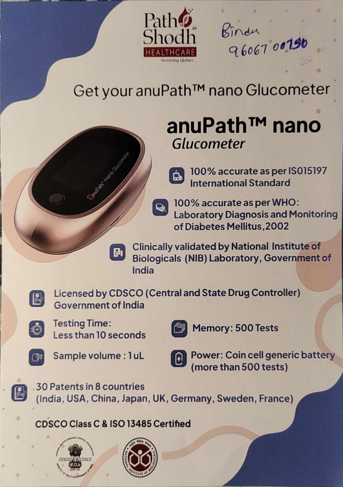
*PathShodh — anuPath™ nano Glucometer spec sheet, with handwritten booth contact (Bindu).*

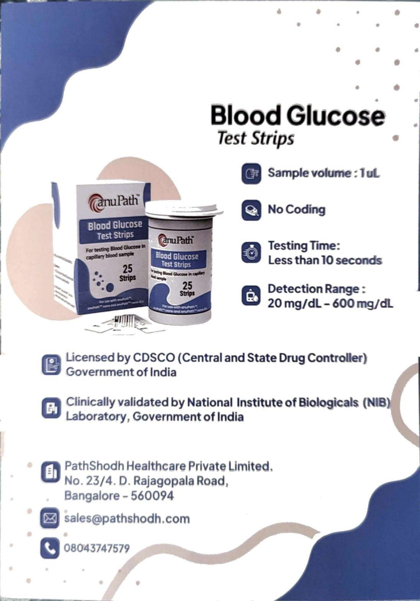
*PathShodh — Blood Glucose Test Strips, CDSCO-licensed.*

#### 12. livelyeco — Rice-husk-based compostable tableware
- **What they showcased:** Plates, bowls, and cups made from rice husk (an agricultural by-product), plus natural straws made from coconut leaf/husk — all home-compostable with no microplastics.
- **Why it stood out:** A genuinely circular-economy pitch — using actual agricultural waste rather than "biodegradable" plastic blends.
- **My Takeaway:** Good fit for event caterers and hospitality businesses trying to cut single-use plastic without switching to flimsy alternatives.

View brochure

*livelyeco — rice-husk plates, bowls, cups and coconut-leaf straws.*

#### 13. JALODBUST — Mechanizing manual scavenging
- **What they showcased:** A vehicle-mounted, battery-powered, single-person-operated system (SaniPreneur™) for de-clogging sewers and handling fecal sludge, with IoT-connected centralized monitoring, already deployed in the field.
- **Why it stood out:** This is solving a genuinely dangerous, dignity-stripping job with real hardware, not another SaaS dashboard — and they had field-deployment photos to back it up.
- **My Takeaway:** One of the few booths at the summit tackling a hard infrastructure/public-health problem head-on rather than an incremental productivity gain.

View brochure

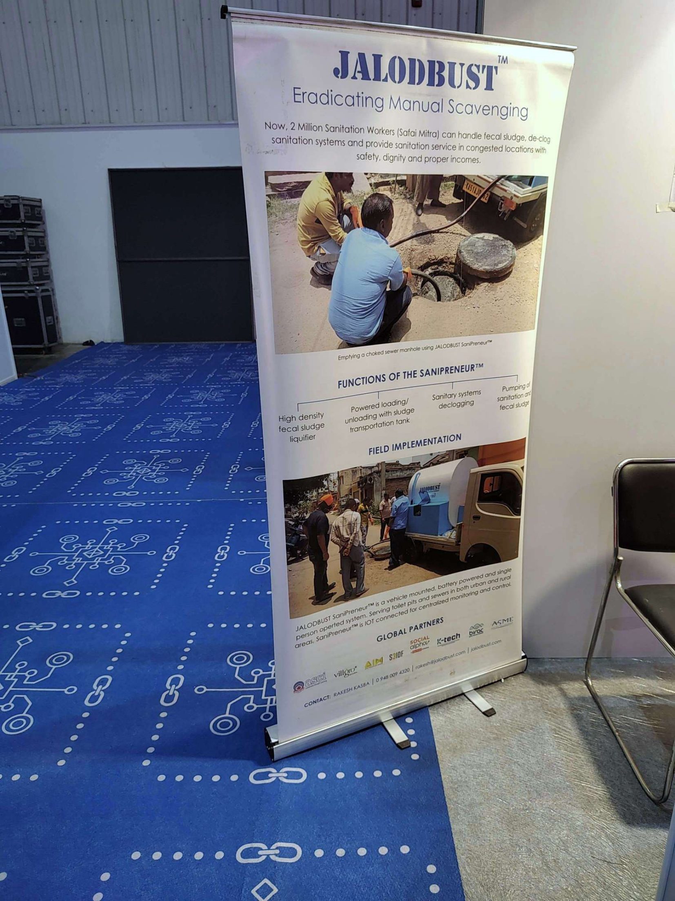
*JALODBUST — SaniPreneur™ field deployment and founder contact (Rakesh Kasba).*

### Mobility

#### 14. Hoopoe E-Bikes — XO-RIDE electric dirt bike
- **What they showcased:** A yellow-and-black electric off-road bike on the floor, branded "Built to Last," alongside a second model marketed under "Xplore · Go Further."
- **Why it stood out:** It's a real vehicle you can sit on, not a brochure — and the neon-lit booth design made it one of the more Instagrammable stops on the floor.
- **My Takeaway:** If you're EV-curious and tired of scooters, worth a test ride; durability claims should be verified independently before buying.

View brochure

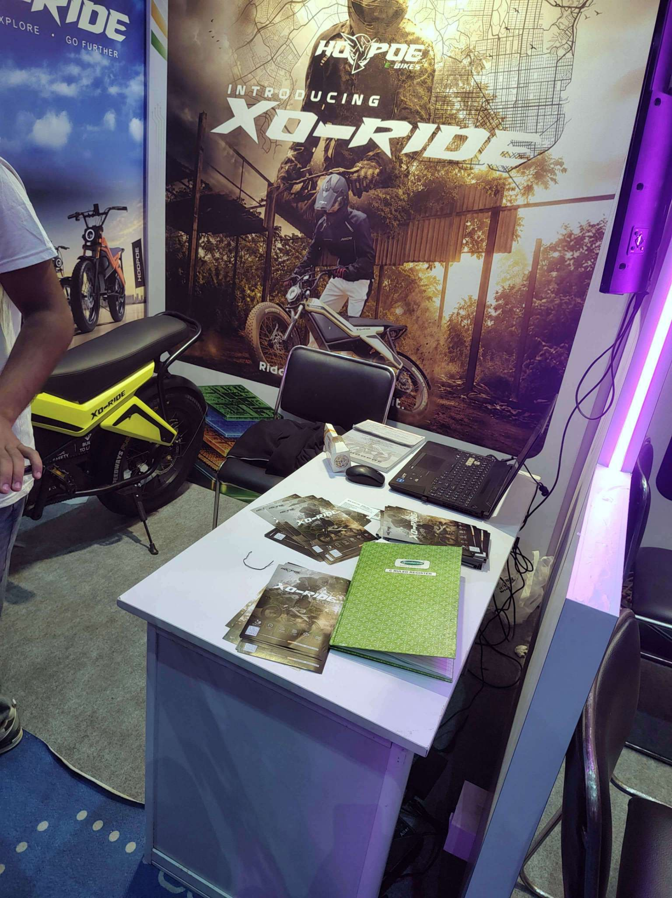
*Hoopoe E-Bikes — the XO-RIDE electric dirt bike on the exhibition floor.*

#### 15. VSD / SFAL — Open-source RISC-V and FPGA teaching kits
- **What they showcased:** Three live programs on the VSDSquadron FPGA Mini board — a high-school chip-design curriculum, a cut-down version of IIT Madras's SHAKTI RISC-V core squeezed onto a Lattice iCE40UP5K FPGA, and a gesture-recognition CNN split across a RISC-V host and 8 parallel DSP lanes on the FPGA.
- **Why it stood out:** This wasn't a slide about RISC-V — it was a live UART console printing `RESULT = 55 (Hex: 0x37) — PASS: sum checked by SHAKTI`, with FPGA utilization stats (98.5%, 5,199/5,280 logic cells) right there on screen. The gesture-AI demo broke down exactly how many MACs (157,188) and cycles (104,157) a gesture inference takes.
- **My Takeaway:** If you're trying to actually teach digital logic and RISC-V rather than talk about it, this is the realest thing I saw all day. Worth it for engineering students and hardware teams alike.

View brochure

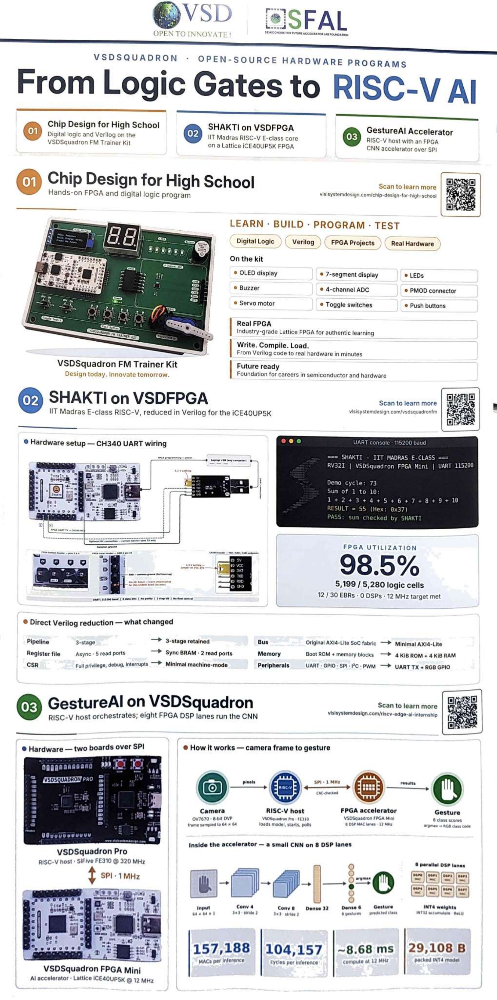
*VSD / SFAL — chip-design, SHAKTI-on-FPGA, and GestureAI accelerator program details.*

### Startups, Platforms & Everything Else

The Startup Pavilion (Hall 4) was dense enough that most booths got a quick note rather than a full writeup — this is the running list from my notebook, booth by booth, organized by category.

**Talent, hiring & workforce**
- **ASPL (Physical AI)** — vision/automotive/biometrics.
- **TruTalent.ai** — talent platform.
- **Utkrushta** — live-prod-env skill assessment: a 45-minute "refactor, fix, improve embeddings" test in a real/live production environment, not a toy coding challenge.
- **CloudRek: Talent** — register as a candidate for coding interviews; contact Vinay Kumar MK.
- **Jobsify AI** / **Findneo** / **zaby** — all "register as candidate" job-matching platforms, zaby pitched as covering "multiple AI roles."
- **Xclub.global** — invite-only network for AI professionals, founders and product leaders (networking, not hiring per se).
- **nitra.ai** — requirements-clarification tool for recruiters/PMs.

**Ops, workflow & SaaS tools**
- **ChatIQ.live** — an AI-powered appointment-booking and lead-management tool (Razorpay payments, online calendar); normally ₹5k/year, but worth asking for their expo offer — a 30-day trial for ₹100.
- **Bizzomation** — 5 pre-built business workflows, ₹10k entry (separate from the tiered Bizzomation pricing on the main brochure — this was a quoted booth price for a smaller package).
- **Apacsoft.com** — doc AI, vision, chatbot, legal OS, LMS, tutor, decision systems; ₹1.5 lakh for an offline, lifetime install.
- **flowverify.co** — contract workflow tool with Aadhaar-based e-signature and OTP verification, priced at ₹50 per signature.
- **Nexumes** — "machine to dashboard" monitoring tool.
- **Pulse** — RCA (root-cause analysis) and compliance tool.
- **Qong Sys** — Python-controlled pick-and-place machine control using TensorFlow.
- **Gaticloud** — GPU cloud hosting; 2 GPU / 100GB / 4GB RAM config, "Gatilite" tier at under ₹1,000/month — notably cheaper than the equivalent AWS spec, and worth asking the booth for a further discount on top of that.
- **Pacesync** — accounts-receivable and doc-AI automation.
- **TestMySkills** — evidence-based skills assessment, linked to CloudDBTech.com for audit/SEO tooling.
- **Divyom.ai** — an LLM router built specifically to cut inference costs.
- **Packet.ai / hosted.ai** — GPU cloud at $3.75/hour for a B200 — roughly 30% of the equivalent AWS cost — with an "INDIA SPECIAL" promo coupon at the booth.
- **Carze: HireSense / CostSense** — HR solutions bundle.
- **True Ledger** — consulting service to set up a US Delaware company for $750.
- **byxstudio.ai** — personal branding and marketing/video production.
- **Carpel & Fast Automate** — AI-driven software testing.
- **Pixa CRM** — general-purpose business CRM.
- **Sendie** — "AI employee" for lead handling.
- **Novalume** — power/energy intelligence platform.
- **Appxcelerate**, **Microkernel** (custom cybersecurity), **Cloud Virtor** (cuts AWS costs), **Soulsorg** (employee engagement), **ynos** (startup-investor connections), **Kontractzy** — quick one-liners, no deep notes.
- **Skydo** — lets Indian businesses receive USD/international payments from the US and UK.
- **photon AI Stores.com** — AI-run storefronts.
- **ezit.club** — platform for passing on digital inheritance (e.g., to a son/heir).
- **taxpress** — GST registration and app development, plus trademark, fundraising and accountant services.
- **QUTRA** — DevOps, HR workflow and agentic-workflow consulting, pricing from ₹3k+ upward.
- **kowach ai** — compliance tooling.

**Hardware, robotics & deep tech (startup pavilion)**
- **Nirwana Grid (Awas)** — a home-energy/appliance automation platform behind-the-wall; Alexa-style scheduling, cloud dashboard, home automation hardware around ₹2-3k for mobile on/off control.
- **Borse Automotive** — an agricultural rover.
- **Bling Mobility** — battery-as-a-service with a 3-minute battery swap for EVs.
- **Vicharak** — edge computing / edge AI SoCs.
- **Akin Analytics** — drone analytics.
- **Tryalesh** — rail-track inspection.
- **Genesis** — "Samridh," a mentor marketplace.
- **Torch It (Jyoti)** — AI vision smart glasses, pitched as a "Google Glass"-style product.
- **Gudlyf** — a fire extinguisher product.
- **inGo Electric** — urban EV mobility, compared directly to Yulu.
- **Khagheshvara** — heavy-payload drones, up to 100kg.
- **Wity (by AlphaNimble)** — a dev-tool/AI coding system (8GB VRAM / 32GB RAM spec, million-token context) built around a single model priced at ₹5 per million tokens, with an extremely fast inference engine; the team positions it as a direct competitor to JEV in that decision-making space.
- **Robotics (ROS2, Isaac Sim)** — simulation booth, tagged with "XR Skill."
- **Quanto** — quantum-security/protection product.
- **PathShodh** — besides the glucometer (see full writeup above), two pricing tiers quoted at the booth — Glucose only ~₹9k, Glucose + HbA1c ~₹12k.
- **Vonyx** — HD AI voice translator.
- **Cloudyali** — reduces cloud hosting bills.
- **iDevopz** — DevOps services.
- **Chotaidea.com** — a marketplace to buy and sell business ideas.
- **adpe** — places ads on partner platforms, claiming 2x conversion.
- **Aavadhi.ai (Clairvoyant Systems)** — AI video surveillance.
- **HubSched** — AI-based attendance tracking.
- **Vidwath** — VLSI/AI/ML training provider.
- **Code Xaureus** — German market-entry/scaling consultancy for Indian products (see also full codeXaureus coverage via their India/Germany brochure).
- **BioSouk** — a milk-quality/certainty testing product.
- **PathShodh nanopath™** — see above.
- **HireXT** — coding assessments at hirext.in, pitched for certified job hunts.
- **Crow** — a food-ordering app.
- **Fused** — "eat & drink," fruit juice and food orders.

**Education, campaigning & misc**
- **study100on100.com / Analyze100on100 / TrainMe100on100** — a family of learning products from the same team: preschool-to-Class-10 learning app with an AI English coach and revision buddy, a statistical-test-selection and inference tool for data analysts, and an instructor marketplace for expert-led courses.

View brochure

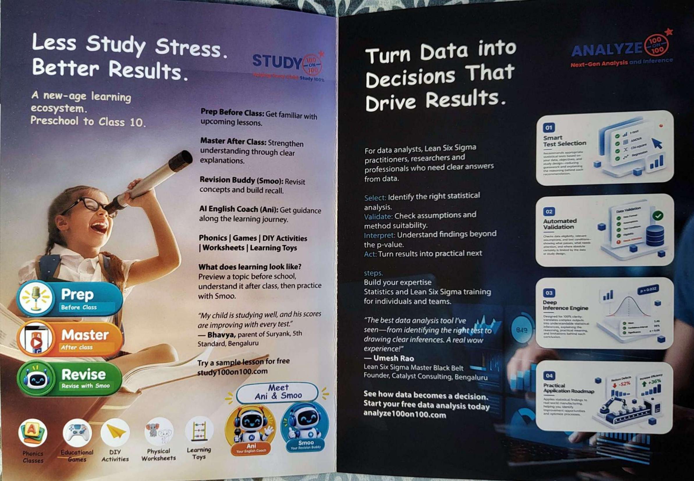
*Study100on100 and Analyze100on100 — K-10 learning app and statistics/Lean Six Sigma analysis tool.*

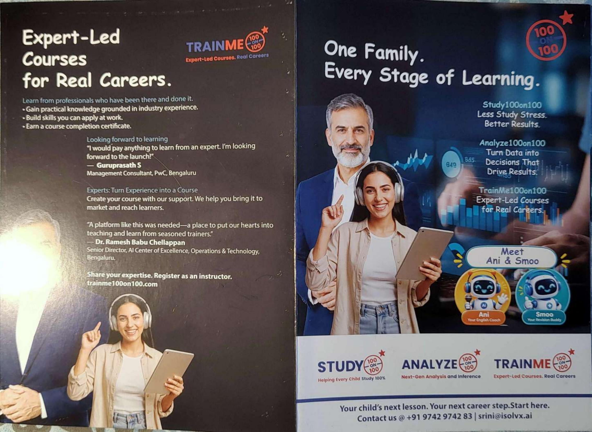
*TrainMe100on100 and the combined "100on100" family branding.*

- **BlessingPalms.com** — eco-friendly disposables.
- **Campaigning Source** — all-in-one startup marketing and political/brand promotion services (35+ tech services offered), 30k+ charges quoted at the booth.

View brochure

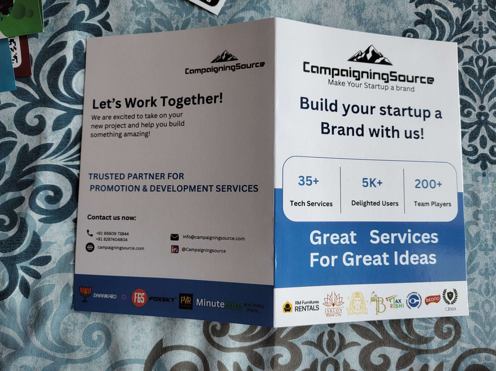
*CampaigningSource — "Build your startup a Brand with us," client/partner logos and contact panel.*

- **100X Coders.com** — jobs, courses and AI learning platform.
- **CoTasker** — task-outsourcing platform.
- **Genesis Idea World** — an idea-submission booth for early founders, prompting visitors with "what problem do I wish to solve" style questions and a QR code to submit ideas.

View brochure

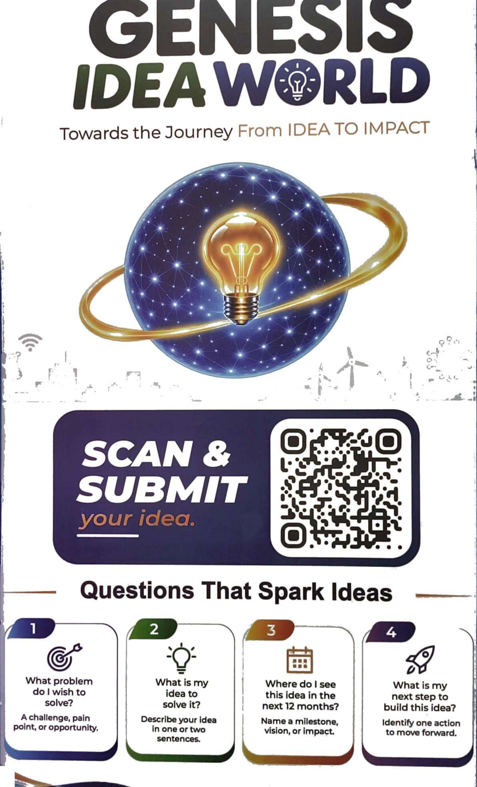
*Genesis Idea World — "Towards the Journey From IDEA TO IMPACT," idea-submission prompts.*

- **EDHAN x Team Dream (Quest)** — an investing-education app ("Learn the market before you risk your money") with bite-sized modules, ₹15,000 virtual-money practice trading, and AI-explained portfolio risk; selected by an international jury at BTS x IFIA Bharat Global Invention & Innovation Connect 2026.

View brochure

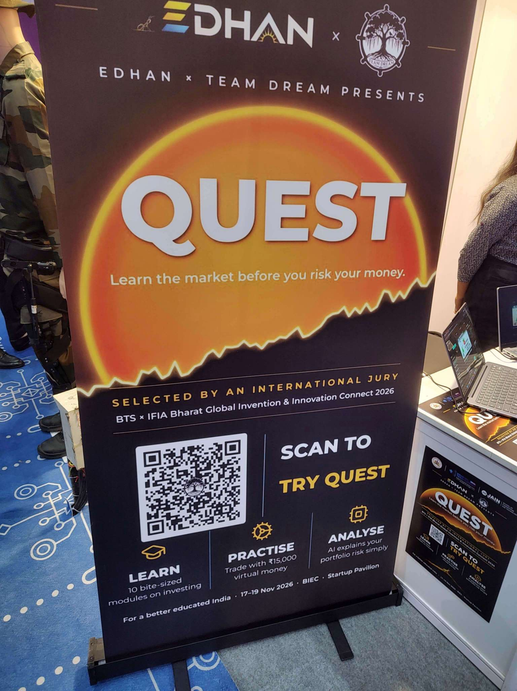
*EDHAN x Team Dream — Quest investing-education app.*

- **websitechatbot.in (LeadPilots)** — a WhatsApp-routed website chat tool: replies to site visitors route to your phone or a shared WhatsApp group, with offline lead capture, a CRM-feeding contact form, and an optional AI layer that answers routine questions and hands off to a human on request.

View brochure

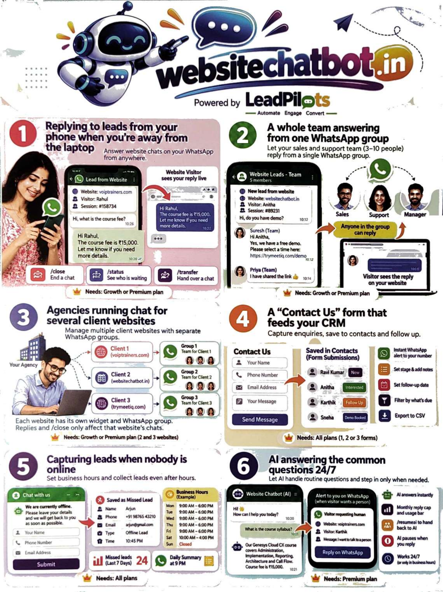
*websitechatbot.in — WhatsApp-routed chat, team inboxes, multi-site agency mode, offline lead capture, AI auto-reply.*

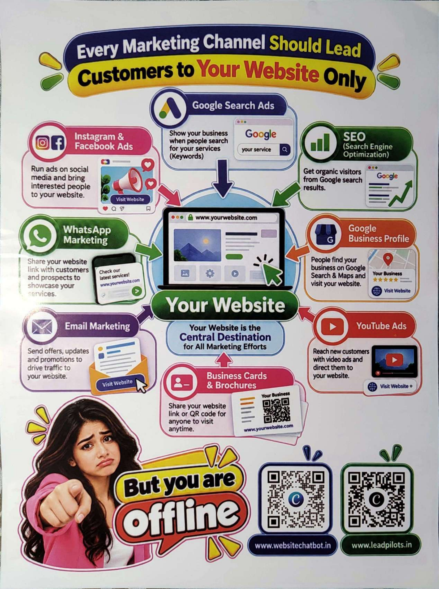
*websitechatbot.in / leadpilots.in — "every marketing channel should lead to your website" pitch.*

**Enterprise IT, incubation & manufacturing software**
- **i-Hub (Gujarat Government Enterprise)** — a government-run startup incubation body spanning pre-incubation, incubation and acceleration programs (mentorship, seed grants, testing/certification, industry co-creation).

View brochure

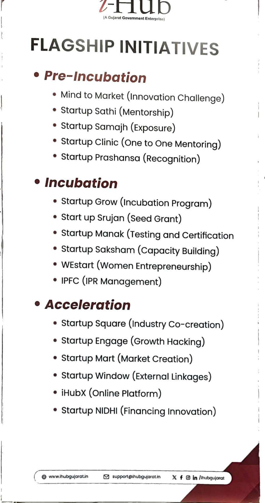
*i-Hub Gujarat — pre-incubation, incubation and acceleration flagship initiatives.*

- **Spunk Systems** — end-to-end IT consulting and managed services (infrastructure, networking, security, cloud), serving banking, manufacturing, healthcare, government, telecom and education clients from Bangalore and Riyadh offices.

View brochure

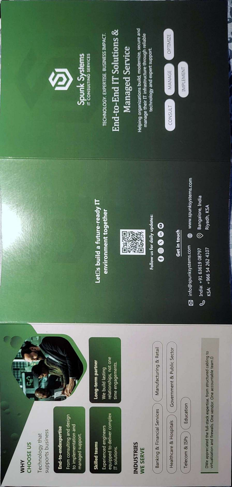
*Spunk Systems — "Technology. Expertise. Business Impact," consult/implement/manage/optimize service pills.*

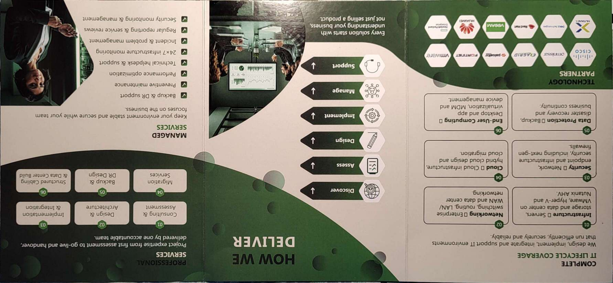
*Spunk Systems — professional services, managed services, and technology-partner logos (HPE, Dell, VMware, Palo Alto, Cisco and others).*

- **Pico Technology (via RevineTech)** — PC oscilloscopes, data loggers and RF test equipment, shown at the booth by local reseller RevineTech.

View brochure

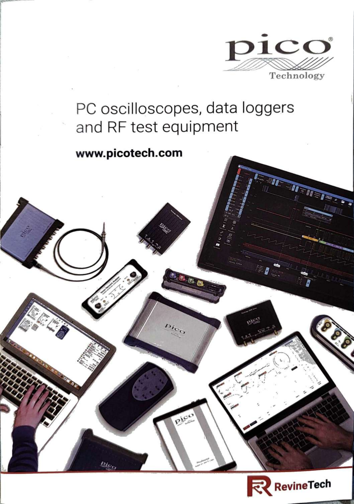
*Pico Technology — oscilloscope and test-equipment product collage, distributed locally by RevineTech.*

- **DHRUV (Dhruv Transformation Solutions)** — manufacturing execution system (MES) consulting, strategic consulting, automation and Siemens Opcenter/APS products, with 17+ years in MES.

View brochure

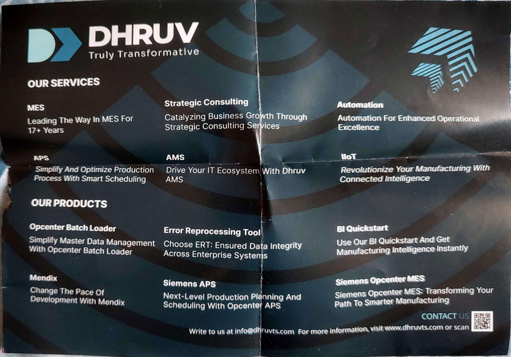
*DHRUV — MES, strategic consulting, automation, APS, and Siemens Opcenter product list.*

- **codeXaureus** — an India-Germany market-entry consultancy: engineers AI/SaaS products in India, then coordinates a network of German specialists (positioning, CRM/ERP integration, digital-trust/encryption) to launch them in the European market.

View brochure

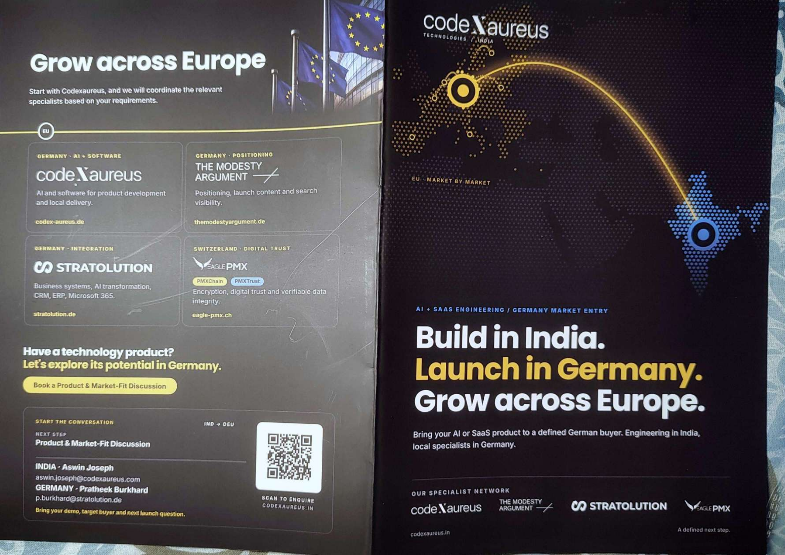
*codeXaureus — "Grow across Europe" partner network (Germany/Switzerland specialists) and India cover page.*

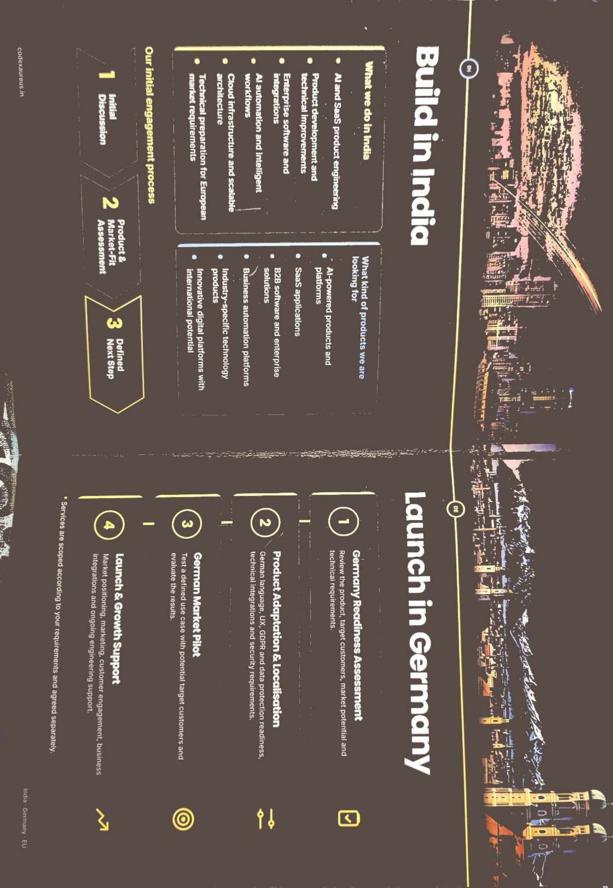
*codeXaureus — Germany market-entry steps and initial engagement process.*

- **VoiceLink (by Elision Group)** — Indian virtual mobile numbers for voicebot telephony, with a ₹99/month expo-only offer and SIP/WebSocket integration across 50+ voice-AI platforms.

View brochure

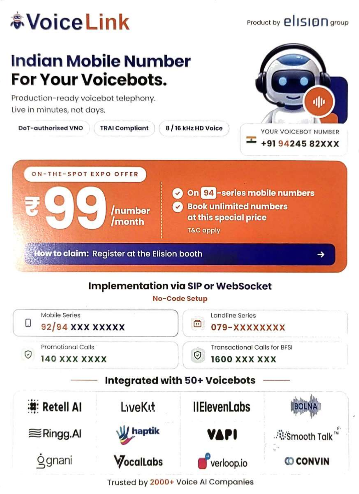
*VoiceLink — "Indian Mobile Number For Your Voicebots," DoT/TRAI-compliant, expo pricing offer.*

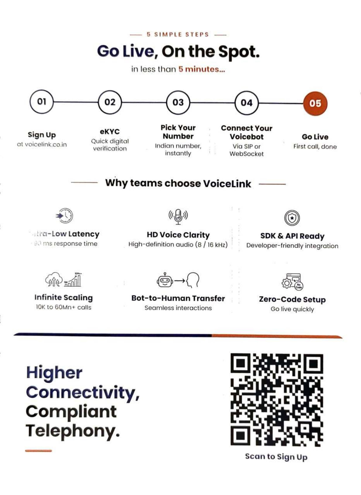
*VoiceLink — 5-step sign-up flow and why-teams-choose-VoiceLink feature list.*

- **MicroKernel IT Services** — AI models, multi-layer security, ERP, custom software, and sector-specific tools (EducationGuru, Yugkrishi crop-info, EV charging software), based in Hinjewadi, Pune.

View brochure

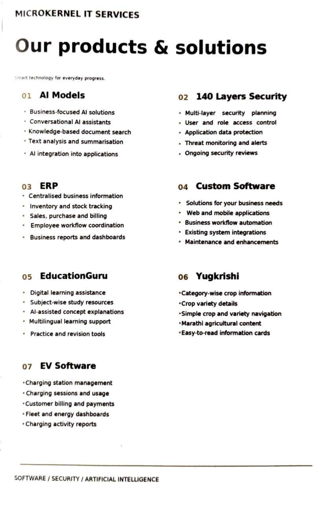
*MicroKernel IT Services — AI Models, 140 Layers Security, ERP, Custom Software, EducationGuru, Yugkrishi, EV Software.*

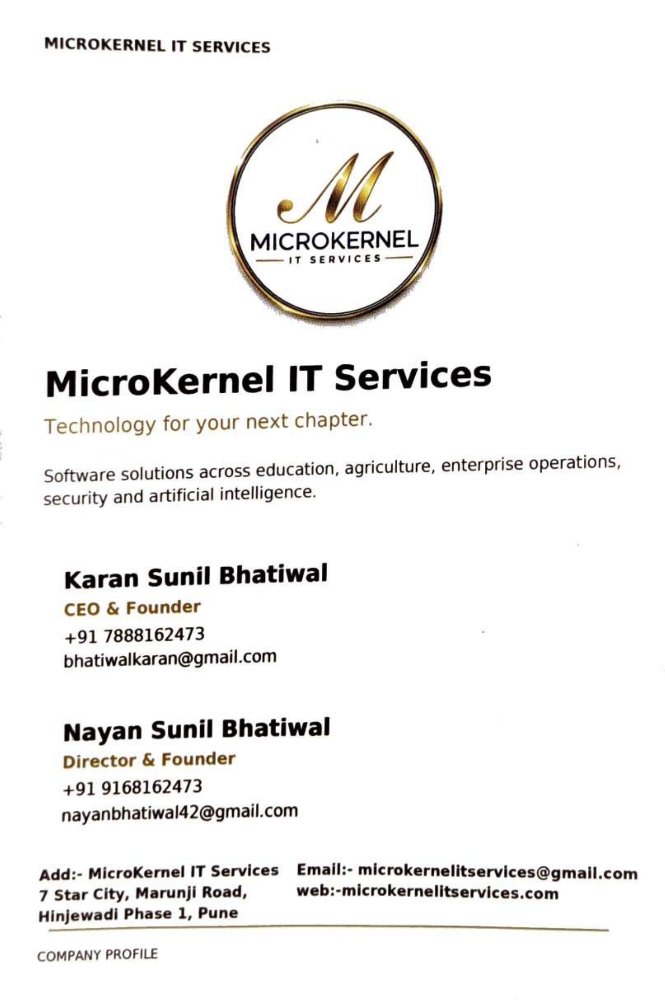
*MicroKernel IT Services — company profile and founder contact panel.*

**Booths known only from a business card** — no brochure photo, so no image here (the booths handed out a card rather than a flyer):
- **Corunner** — an "AI coworker" productivity tool.
- **Caze Labs** — precision AI products: Caze CostSense (IT/AI spend optimization), Caze HireSense (candidate assessment), Caze AISense (secure AI automation).
- **Intelous IO Private Limited** — a RevOps consulting firm, Bengaluru.
- **Dreamstorey** — an events/guest platform that generates a guest ID instead of collecting phone numbers at check-in, so your number never leaks to the venue or organizer; priced at ₹1,250/month for up to 1,500 guests.
- **TimBuckDo (Timbuckdo Innovations)** — an events/guest-management SaaS linked with Dreamstorey.
- **BizExpress** — CA services, company incorporation, trademark and fundraising support, offices in Bangalore, Mumbai and Gurgaon.
- **FindNeo** — a "register as candidate" job-matching platform.

**My overall read on this stretch of the floor:** this was by far the densest, scrappiest part of the summit — dozens of two-person booths, most pitching a narrow tool at a specific price point rather than a platform. A few (Bling Mobility's battery swap, Torch It's AI glasses, Khagheshvara's heavy-payload drones) felt genuinely novel hardware plays; most of the rest were variations on "AI + [existing workflow]" with pricing tacked on as the differentiator.

## Key Trends & Patterns

- **Agentic is the default pitch now, not the exception.** Nearly every "AI" booth — Algorizz, QUTRIX, SierraEdge, VirpanAI — described itself in terms of agents/workflows handling multi-step work, not single-shot chatbots. The chatbot-only pitch has essentially disappeared from this floor.
- **"Sovereign" and "indigenous" showed up constantly.** SierraEdge, VSD/SFAL, and several hardware booths explicitly marketed India-built, NDA-governed, defense-adjacent capability as a selling point, not a footnote — a noticeably stronger theme than at past summits.
- **Hiring/assessment tech was oversaturated.** Between HireXt, CloudRek, JobsifyAI, FindNeo, TruTalent.ai, and 100X Coders, "AI scores your resume/interview" was the single most repeated pitch of the day — differentiation here is going to come down to data and placement outcomes, not features.
- **What was missing:** few climate-tech or hardcore - and no foundation-model work. Outside of livelyeco and the EV booths, sustainability was thin, and not many on the floor was training / fine tuning models — everyone was building on top of existing LLMs - except for Wity which had a fast sys one model. 

